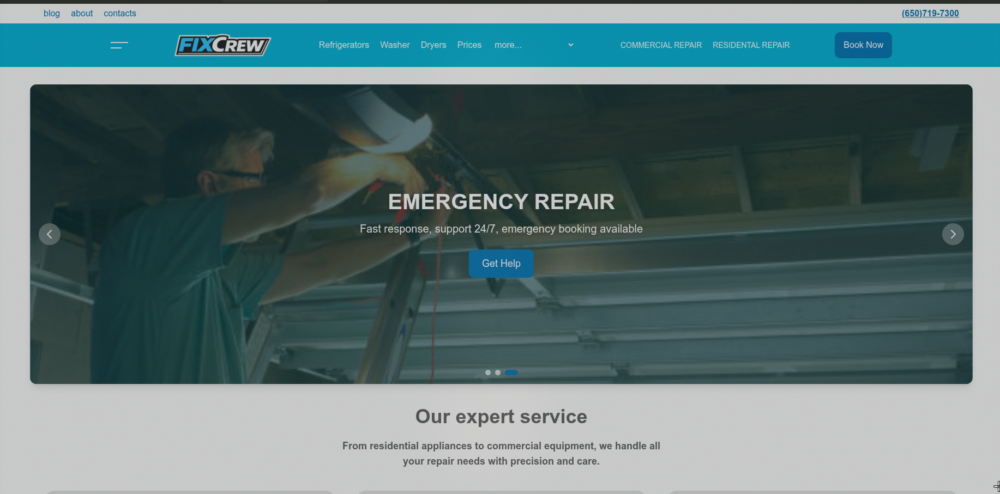

# FixCrew



## Links

### Languages

- [Russian (Русский)](../../README.md)
- [English (Английский)](./README.md) - **Develops now**

### Documentation

- [Api](Api.md) - Backend Structure
- [Ui](Ui.md) - Frontend Structure
- [Contributors](Contributors.md) - Contributors of Project
- [Credits](Credits.md) - Used technologies
- [Env](Env.md) - environment values definitions

## Quick Start

```bash
git clone https://github.com/TemaXo00/fixcrew-web-application.git
cd fixcrew-web-application
cp .env.example .env
docker compose up --build
```

## Tech Stack

### API


### UI


### Infrastructure


## Getting Started

### Project structure

```text
.
├── api                     # Backend folder
├── config                  # Configs for metric apps
├── docker-compose.yml      # Docker entrypoint
├── docker-files            # Dockerfiles for Apps
├── .dockerignore           # Docker ignored files/folders
├── docs                    # Documentation
├── .env.example            # Environment variables example
├── .gitignore              # Git ignored files/folders
├── README.md               # Main documentation file
└── ui                      # Frontend folder

```

### Launch application
To provide full application working, you must clone this repo:

```bash
git clone https://github.com/TemaXo00/fixcrew-web-application.git
```

After it, you must enter directory and setup environment variables by [this guide](Env.md). For basic launch, you can use example variables:

```bash
cd fixcrew-web-application
cp .env.example.env
# If you want to change env, you can use any text editor, example:
nano .env
```

Now you can start application by using Docker:

```bash
docker compose up --build
```

### Troubleshooting

#### Ports
Error example:

```bash
Error response from daemon: failed to set up container networking: driver failed programming external connectivity on endpoint fixcrew-ui-main (): failed to bind host port [::]:5173/tcp: address already in use
```

Fix:
```bash
# Check port usage
# Linux/MacOS
sudo netstat -tulnp | grep :port
# Windows
netstat -aon| find «port»
```

When you find out what blocking port, you can try:
1. Change port of app by env
2. Disable application, which block port

#### One or more services not working
```bash
# Find out what containers exited
docker ps -a
# Check out logs
docker compose logs "name of service"
# Try to restart
docker compose restart "name of service"
```

When you find out, that app have errors, you can message about it in [Issues page](https://github.com/TemaXo00/fixcrew-web-application/issues) or create fix and create pull request with fix